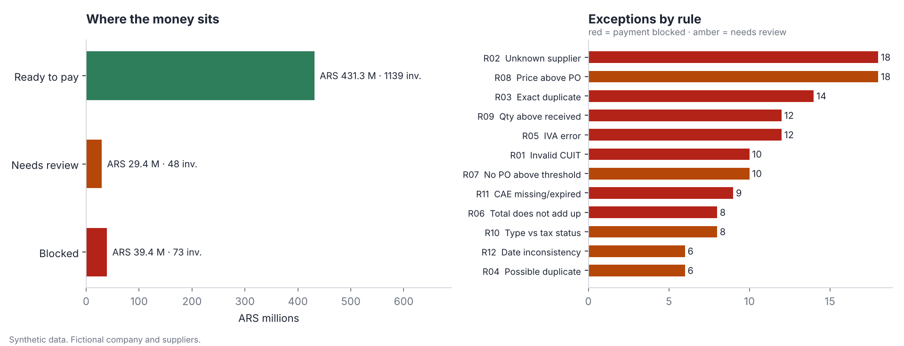

# AP invoice control

**Accounts payable control for a (fictional) Argentine company: CUIT validation, 3-way match and an exception list that a payables team can work through before the payment run.**

*Versión en español más abajo.*



## The problem

A shared-services AP team receives hundreds of supplier invoices a month. Most are fine. The expensive ones are the few that are not: a duplicate keyed twice, an invoice for more units than the warehouse received, a price that drifted above the purchase order, a CUIT with a typo, IVA that does not add up. Finding them by eye is slow and inconsistent, and they usually surface after the money has left.

## What this does

It runs 12 documented rules over every invoice and sorts each one into **ready to pay**, **needs review** or **blocked**, with the reason attached.

| Code | Rule | Action |
|---|---|---|
| R01 | Supplier CUIT fails the check-digit validation | block |
| R02 | Supplier not in the supplier master | block |
| R03 | Exact duplicate (CUIT, type, point of sale, number) | block |
| R04 | Possible duplicate: same supplier and total within 7 days | review |
| R05 | IVA rate not allowed, or IVA ≠ net × rate | block |
| R06 | Total ≠ net + IVA + other taxes | block |
| R07 | No purchase order on an invoice above ARS 250,000 | review |
| R08 | Unit price more than 2 % above the purchase order | review |
| R09 | Quantity invoiced above quantity received | block |
| R10 | Invoice type inconsistent with the supplier's tax status (A vs C) | review |
| R11 | CAE missing, malformed or expired at invoice date | block |
| R12 | Invoice date in the future, or due date before invoice date | review |

Thresholds and tolerances live at the top of [`src/apcontrol/rules.py`](src/apcontrol/rules.py), so finance can change them without touching the logic.

## Result on the sample data

1,260 invoices, ARS 500.2 M in total (synthetic, March–August 2026):

| Status | Invoices | Amount |
|---|---:|---:|
| Ready to pay | 1,139 | ARS 431.3 M |
| Needs review | 48 | ARS 29.4 M |
| Blocked | 73 | ARS 39.4 M |

Outputs in [`output/`](output/): `exceptions.csv` (one row per invoice with the rules it hit), `rule_summary.csv`, and `ap_review.xlsx` with four sheets: status, rules, exceptions and control totals.

## How I know the numbers are right

- **Control totals.** Every invoice and every peso has to land in exactly one status. The run stops if the count or the amount in does not equal the count or amount out.
- **Recall and precision against known issues.** The data generator records every issue it injects (121 of them). The tests check that each one is caught by its rule, and that none of the untouched invoices is flagged.
- **Join safety.** Merging suppliers, purchase orders and goods receipts must never duplicate an invoice; there is a test and an assertion for it.

Note that rules can overlap by design: an invoice with a mistyped CUIT (R01) is also not found in the supplier master (R02).

## Run it

```bash
pip install -r requirements.txt
python scripts/generate_data.py   # rebuild the synthetic data (seeded, reproducible)
python run.py                     # run the control and write output/
python -m pytest -q               # 7 tests
```

## Data

Everything is synthetic: 60 fictional suppliers (companies and monotributistas), 1,100 purchase orders with goods receipts, and 1,260 invoices. CUITs are generated with a valid check digit and belong to no one. No real company, person or invoice is represented.

---

## Versión en español

**Control de cuentas a pagar para una empresa argentina ficticia: validación de CUIT, conciliación entre orden de compra, recepción y factura, y una lista de excepciones para revisar antes de la corrida de pagos.**

**El problema.** Un equipo de cuentas a pagar recibe cientos de facturas por mes. La mayoría está bien; las que cuestan plata son las pocas que no: una factura cargada dos veces, más unidades que las recibidas, un precio por encima de la orden de compra, un CUIT mal tipeado, un IVA que no cierra. Encontrarlas a ojo es lento, y casi siempre aparecen cuando el pago ya salió.

**Qué hace.** Aplica 12 reglas documentadas (tabla de arriba) a cada factura y la clasifica en **lista para pagar**, **revisar** o **bloqueada**, con el motivo. Las tolerancias y umbrales están al principio de `rules.py` para que el área de finanzas las ajuste sin tocar la lógica.

**Resultado con los datos de ejemplo.** 1.260 facturas por ARS 500,2 M: 1.139 listas para pagar (ARS 431,3 M), 48 para revisar (ARS 29,4 M) y 73 bloqueadas (ARS 39,4 M). Salidas: `exceptions.csv`, `rule_summary.csv` y un Excel con estado, reglas, excepciones y totales de control.

**Cómo sé que los números están bien.** Totales de control (cada factura y cada peso cae en un solo estado, o el proceso se detiene); tests que verifican que se detectan las 121 anomalías cargadas a propósito y que ninguna factura limpia queda marcada; y un control para que los cruces de tablas no dupliquen facturas.

**Datos.** Todo es sintético: proveedores, CUIT, órdenes de compra y facturas inventados. No representa a ninguna empresa ni persona real.

---

Pablo Pavón · Senior Business & Data Analyst · [pablodpavon.github.io](https://pablodpavon.github.io)
